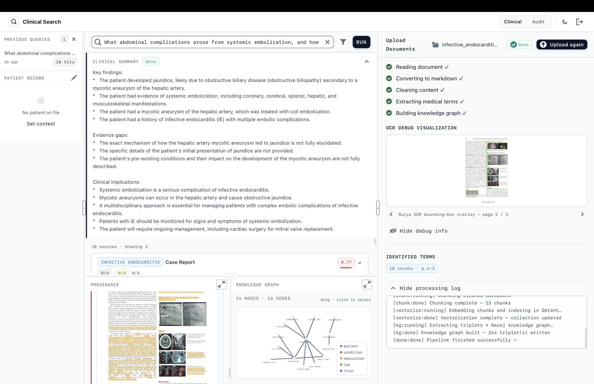

# Documentation

Pages are grouped by job. Guides are how you run the platform. Reference is how it is built. Operations is CI and RunPod. Sessions are dated notes. Research is design notes and eval writeups.

## Guides

| Document | Description |
|----------|-------------|
| [Quickstart](guides/quickstart.md) | Local install and first run |
| [Production Startup](guides/prod-startup.md) | Ubuntu 22.04 and an NVIDIA L4: services, inference, and the Blueprint UI |
| [Make Reference](guides/make-reference.md) | Root `make` targets |

## Reference

| Document | Description |
|----------|-------------|
| [Architecture](reference/architecture.md) | Module topology and data flow |
| [Data Pipeline](reference/data-pipeline.md) | Ingestion stages from PDF to graph and vectors |
| [Agent Framework](reference/agent-framework.md) | Reasoning runtime and tools |
| [Configuration](reference/configuration.md) | `config/app.yaml` field reference |
| [API Reference](reference/api-reference.md) | FastAPI request and response shapes |
| [Backend Endpoints](reference/backend-endpoints.md) | Query, retrieval, and ingestion endpoints, including SSE |
| [UI Integration](reference/ui-integration.md) | Contracts for replacing UI mock data with live responses |

## Operations

| Document | Description |
|----------|-------------|
| [RunPod Terraform](operations/terraform-runpod.md) | Apply and destroy the GPU pod from a saved RunPod template |
| [CI](operations/ci.md) | What `.github/workflows/ci.yml` runs and why |

## Sessions

| Document | Description |
|----------|-------------|
| [RunPod — 2026-08-01](sessions/runpod-2026-08-01.md) | Auth, ports, and the first pod bring-up |
| [RunPod — 2026-08-02](sessions/runpod-2026-08-02.md) | Proxy auth, ingestion moved to port 8002 |
| [RunPod — 2026-10-10](sessions/runpod-2026-10-10.md) | Incident: login, then OCR blocked on Docker and glibc |
| [Spot Instance Postmortem](sessions/spot-instance-postmortem.md) | What came up on a spot box, and why it was terminated |

## Research

| Document | Description |
|----------|-------------|
| [Query Prompts](research/query-prompts.md) | Trial-matching and evidence prompts for manual checks |
| [Query Suite](research/query-suite.md) | Staged checks for OCR, retrieval, and graph reasoning |
| [Reranker](research/reranker.md) | Recall change after cross-encoder reranking |
| [Statistical Provenance](research/statistical-provenance.md) | Recall, precision, and extraction metrics |
| [Fact-level Provenance](research/fact-level-provenance.md) | Plan for byte-range provenance, entity resolution, and resume |
| [Surya OCR](research/surya-ocr.md) | What Surya v2 changes relative to the v1 extractor |
| [LM Studio Models](research/lm-studio-models.md) | Local model choice for reasoning and extraction |
